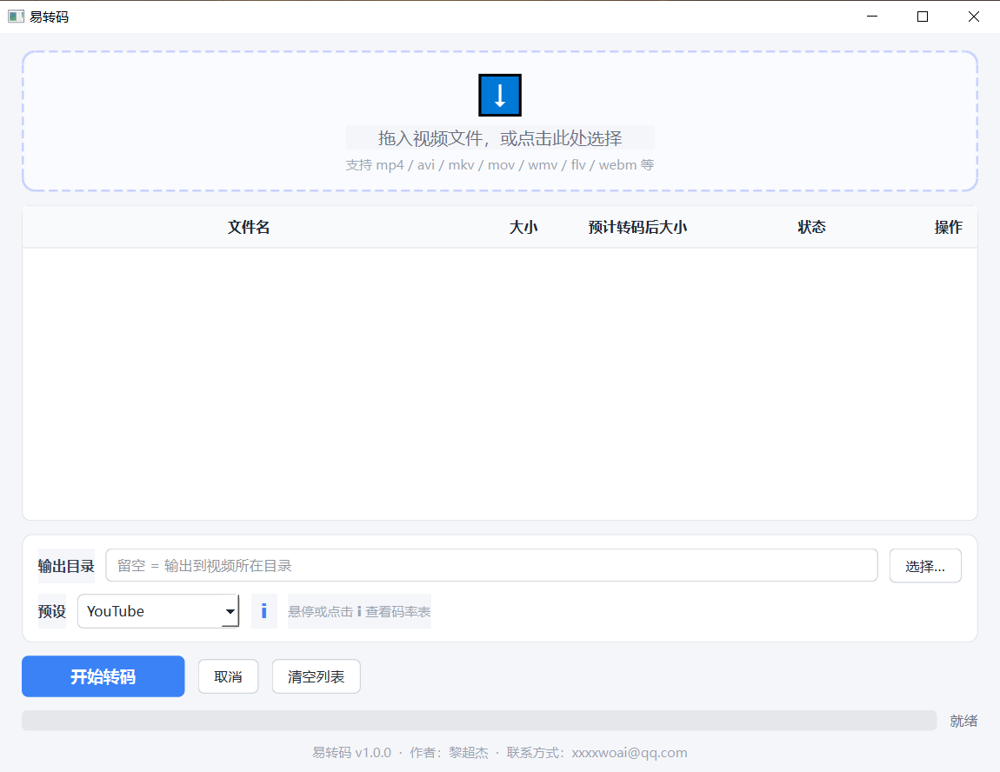

# YiZhuanma (易转码)

> English | [中文](README.md)

A video / image conversion tool for Windows: drag in videos and it transcodes
them automatically using YouTube's recommended bitrate table, or switch to
"Image" mode to batch-compress large photos into a target size range. Uses
hardware encoding when an NVIDIA/AMD/Intel GPU is available, and falls back to
CPU automatically otherwise.

Author: Chaojie Li (黎超杰)  Contact: xxxxwoai@qq.com

## Screenshot



## Features

### Video mode

- Drag & drop or select multiple videos (mp4, avi, mkv, mov, wmv, flv, webm, ts, m4v, etc.)
- Output directory defaults to a `已转码` (transcoded) folder next to the first
  video (auto-created, still editable); the folder opens automatically when
  transcoding finishes. Output filename is `original-name.mp4` (auto-appends a
  number when the source is already mp4 to avoid overwriting)
- Preset: YouTube (standard bitrate videos, hover the ℹ icon to see the bitrate table)
- **Skips transcoding when the estimated result would be larger than the
  source**: the source file is copied into the output directory as-is (original
  extension kept) and the row is marked as finished
- Automatic bitrate matching: picks a tier from the table based on the video's
  short edge and frame rate (H.264 + AAC, MP4 container)
- Automatic encoder selection: h264_nvenc (NVIDIA) → h264_amf (AMD) →
  h264_qsv (Intel iGPU) → libx264 (CPU fallback)
- Falls back to CPU encoding when hardware encoding fails — jobs never abort

### Image mode

Switch to **Image** at the top of the window (each mode keeps its own list, so
switching back and forth never loses work):

1. **Choose directory** → **Load**: recursively scans jpg / jpeg / png / bmp /
   webp / tif images (the `已转码` output folder is skipped)
2. **Size filter**: enter x MB (default 20.0). Only images **larger than x MB**
   are listed; changing the value re-filters immediately without re-scanning
3. **Start**: the result must be **smaller than (x-1) MB** and is kept at or
   above x/2 MB where possible (e.g. x = 5 → target 2.5 MB ~ <4.0 MB)

- Compression: JPEG quality is binary-searched for the highest quality that
  fits under the cap; if even the lowest quality is too large, the image is
  downscaled and retried
- Output is always JPG (alpha flattened onto white); EXIF orientation is applied
- Camera RAW files (NEF / CR2 etc., even when renamed to .jpg) are transcoded
  from their embedded full-size preview; if only a thumbnail can be decoded the
  row fails with a clear hint instead of silently writing a tiny image
- List columns: name / original size / transcoded size / status; before
  transcoding the target is shown (`<4.0 MB`), afterwards the actual size
  (green = in range, orange = under the lower bound)
- Output defaults to an auto-created `已转码` folder next to the source, and
  opens automatically when finished
- Cancellable; image mode does not need ffmpeg

## Bitrate Table (YouTube standard bitrate videos)

| Short edge  | ≤30fps video bitrate | >30fps video bitrate | Audio bitrate |
|-------------|----------------------|----------------------|---------------|
| ≤480p       | 800k                 | 1800k                | 128k          |
| ≤720p       | 2200k                | 3200k                | 128k          |
| ≤1080p      | 6000k                | 9000k                | 192k          |
| ≤1440p (2K) | 12000k               | 18000k               | 192k          |
| ≤2160p (4K) | 30000k               | 45000k               | 256k          |

Tier rule: the short edge picks the smallest tier covering the current
resolution (e.g. 900p → 1080p tier); frame rates above 30fps use the
higher-bitrate column.

## Development

```bash
python -m pip install -r requirements.txt
python main.py
```

Requirements: Python 3.11+, and ffmpeg/ffprobe on your machine (during
development it looks in PATH or C:/ffmpeg/bin).

## Building & Distribution

Double-click `build.bat`; the artifact is `dist/易转码-v<version>.exe` (single
file, no installation, zero dependencies for end users). The version is read
automatically from `yizhuanma/__init__.py` (e.g. `易转码-v1.3.0.exe`).

Notes:
- The build bundles ffmpeg.exe / ffprobe.exe into the exe
- **For commercial distribution, replace C:/ffmpeg/bin with an LGPL build of
  ffmpeg** (e.g. BtbN's ffmpeg-latest-win64-lgpl) to avoid GPL license
  contamination
- If antivirus software raises false positives, change `--onefile` to
  `--onedir` in build.bat (folder mode has a lower false-positive rate)

## Project Structure

```
main.py              Entry point
yizhuanma/
  __init__.py        Version / author info
  presets.py         Platform bitrate tables + tier selection
  transcoder.py      ffprobe probing, encoder selection, ffmpeg invocation, progress parsing
  image_transcoder.py Image scanning/filtering, JPEG binary-search compression to a target range
  ffmpeg_util.py     ffmpeg/ffprobe discovery (dev / packaged)
  ui.py              PySide6 UI (mode switch, drag & drop, task list, hover bitrate table)
build.bat            PyInstaller build script
```
